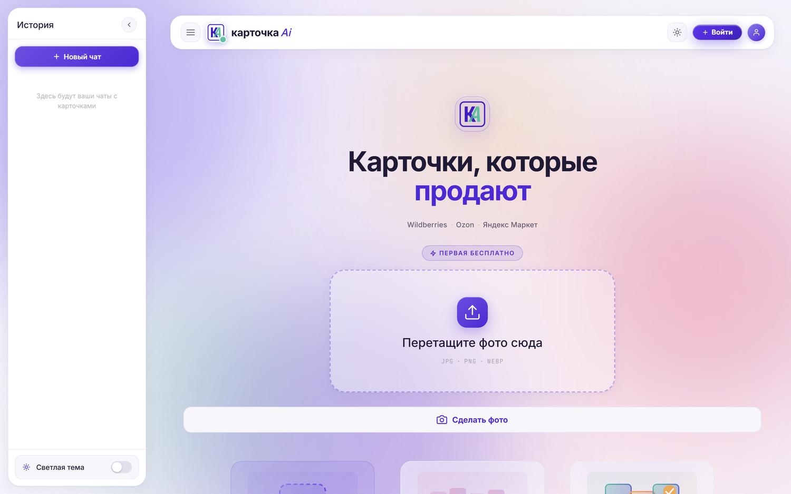
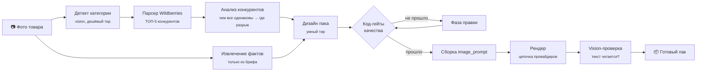
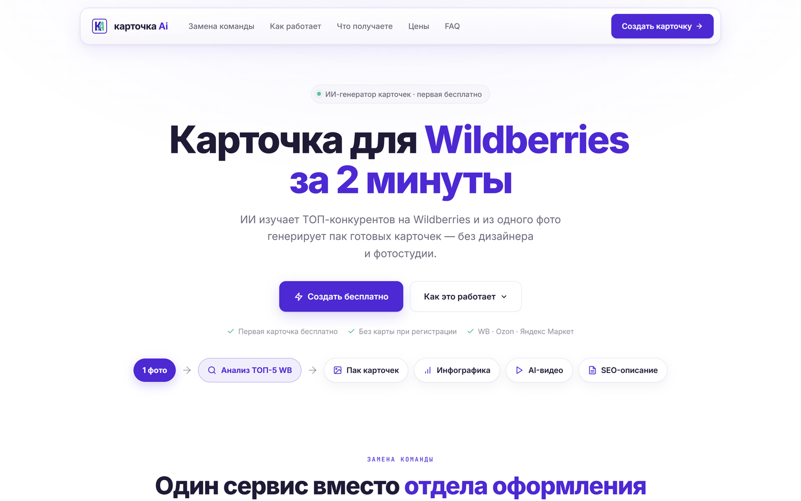
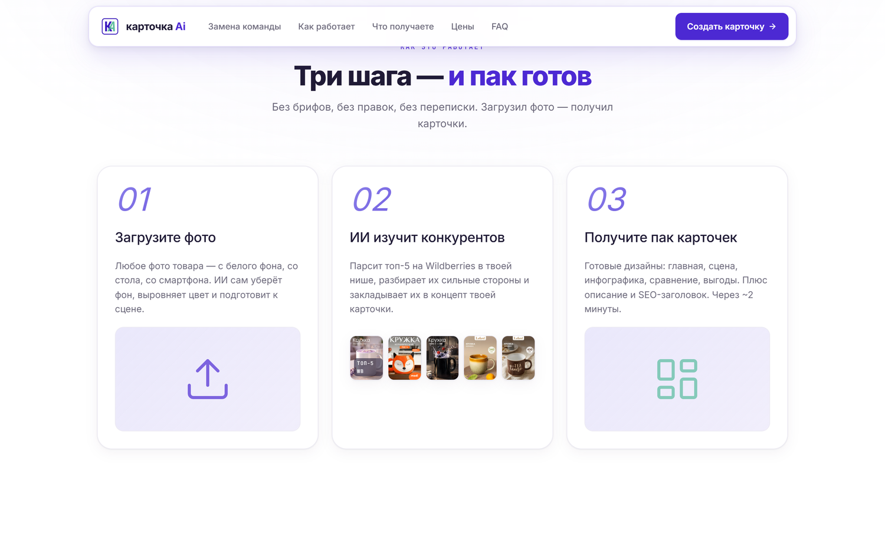
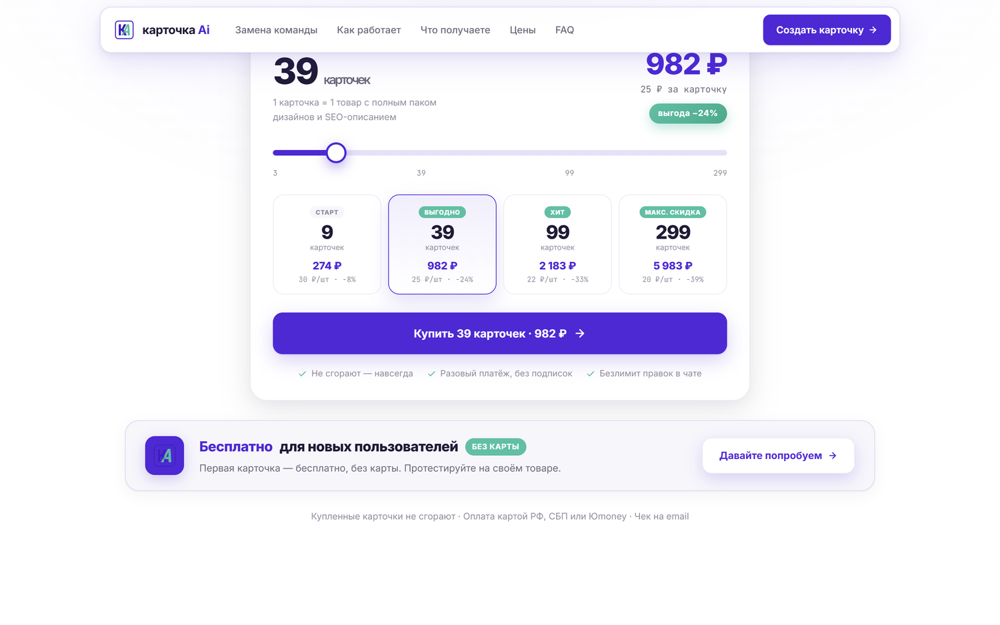
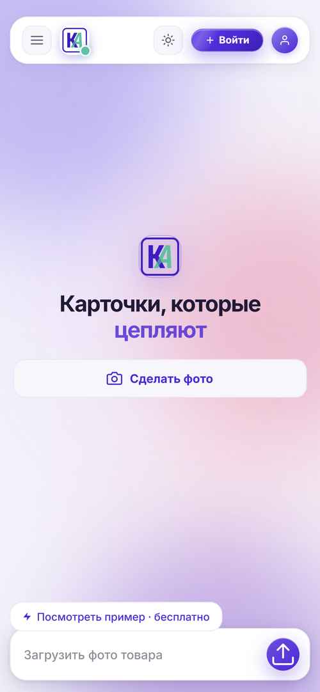

<div align="center">


# карточка Ai

**Из одного фото товара — готовый пак карточек для Wildberries, Ozon и Яндекс Маркета. За две минуты.**

ИИ анализирует ТОП-5 конкурентов в нише, находит, чем они все одинаковы,
и строит карточку, которая от них отличается.


<sub><b>EN</b> — AI service that turns a single product photo into a full set of
marketplace listing images. It parses the top-5 competitors for the niche, extracts
what they all have in common, and designs a card that breaks the pattern.
Python/FastAPI backend, vanilla-JS SPA, Kotlin WebView app, LLM pipeline with
code-enforced quality gates. Built and shipped solo. Prompt texts are redacted —
see <a href="docs/prompt-system.md">docs/prompt-system.md</a>.</sub>

</div>



---

## Что это

Работающий коммерческий продукт, а не учебный проект: сервер, веб-приложение,
Android-приложение, биллинг, приём платежей и деплой на боевой сервер.
Спроектировано и написано в одиночку — от парсера маркетплейса
до экрана оплаты.

Продавцу на Wildberries карточка нужна каждую неделю, а дизайнер стоит
от 1500 ₽ за штуку и делает её три дня. Сервис закрывает эту задачу
за две минуты и без брифа.

---

## Результат на реальном товаре

Слева — то, что загрузил пользователь. Справа — что вернул сервис.

<table>
<tr>
<td width="20%" align="center">
<br>
<sub><b>Вход:</b> фото со стола</sub>
</td>
<td width="80%">


<br>
<sub><b>Выход:</b> пак карточек — главная, макро-фактура, лайфстайл, инфографика + SEO-описание</sub>
</td>
</tr>
</table>

**Что при этом произошло под капотом:** сервис распарсил ТОП-5 чайных пар
на WB, увидел, что все снимают на тёмных нейтральных фонах и почти не
показывают рельеф, и построил концепт «чистый светлый фон + макро-кадр
фактуры + эмоция подарка» — то есть ровно в незанятой нише.

---

## Как это работает



Главное решение здесь — **гейты качества написаны кодом, а не промптом**.
Правило «не выдумывай характеристики» в промпте работает «почти всегда»,
а в коде — всегда. Подробно: [docs/prompt-system.md](docs/prompt-system.md).

---

## Интерфейс

| Лендинг | Как это работает |
|---|---|
|  |  |

| Калькулятор цены | Мобильная версия |
|---|---|
|  |  |

---

## Архитектура

```
site/                      FastAPI-бэкенд
├── server.py              HTTP-слой, SSE-стриминг генерации
├── generator.py           оркестратор конвейера
├── prompts.py             шаблоны + валидаторы качества
├── wb_parser.py           парсер Wildberries с цепочкой фолбэков
├── wb_analyzer.py         анализ конкурентов
├── accounts/              аккаунты, биллинг, платежи
│   ├── security.py        хеширование паролей (scrypt)
│   ├── db.py              слой данных на чистом sqlite3
│   ├── service.py         бизнес-логика
│   ├── oauth.py           вход через Google / Яндекс
│   └── payments.py        абстракция платёжного провайдера
└── static/                SPA на чистом JS, без сборки

android/                   Kotlin WebView-обёртка
deploy/                    systemd + nginx + скрипты выката
```

Внешних зависимостей минимум: база — стандартный `sqlite3` без ORM,
фронтенд — без фреймворка и без бандлера, хеширование — из stdlib.
Это осознанный выбор под масштаб «один сервер»: меньше движущихся частей,
которые могут сломаться в проде в три часа ночи.

---

## Решения, которые считаю интересными

**Хеш пароля хранит свои параметры.**
Формат `scrypt$n$r$p$salt$hash` — стоимость вычисления лежит внутри строки.
Поднять cost через год можно без ломки существующих пользователей: старые
хеши продолжат проверяться со своими параметрами.
→ [`accounts/security.py`](site/accounts/security.py)

**Сессии — непрозрачные серверные токены, а не JWT.**
Клиенту не отдаётся ничего, чему можно доверять: идентичность живёт только
в базе. Подделывать нечего, отзыв сессии мгновенный.
→ [`accounts/security.py`](site/accounts/security.py)

**Все записи в базу — через одну транзакционную точку.**
Единственное соединение под reentrant-локом, любая запись идёт через `tx()`
с BEGIN/COMMIT/ROLLBACK. Плюс `_ensure_column()` — миграции на 15 строк
вместо Alembic.
→ [`accounts/db.py`](site/accounts/db.py)

**Привязка соц-входа только по подтверждённому email.**
Классический вектор захвата аккаунта — вход через провайдера, который отдаёт
чужой неподтверждённый адрес. Непроверенный email уходит в синтетический
плейсхолдер и не используется для идентификации.
→ [`accounts/oauth.py`](site/accounts/oauth.py)

**Парсер, который не умирает от антибота.**
Ротация User-Agent, пул токенов, несколько независимых источников данных
и внятная диагностика вместо молчаливого падения: на 429 парсер прямо
говорит, что IP в рейт-лимите.
→ [`wb_parser.py`](site/wb_parser.py)

**Стоимость как параметр архитектуры.**
Каждая задача конвейера привязана к тиру модели (`smart` / `balanced` /
`vision_cheap` / `cheap`), тир мапится на модель в конфиге. Дорогая модель
работает только там, где это видно в результате.
→ [`docs/prompt-system.md`](docs/prompt-system.md)

---

## Запуск локально

### Демо без API-ключей

Для просмотра проекта достаточно Python 3.11+ и двух зависимостей. В Windows можно запустить `START_DEMO.cmd` двойным кликом или выполнить в PowerShell:

```powershell
git clone https://github.com/Kuzemko03/kartochka-ai.git
cd kartochka-ai
python -m venv .venv
.\.venv\Scripts\python.exe -m pip install -r requirements-demo.txt
.\.venv\Scripts\python.exe demo.py
```

В macOS/Linux после клонирования:

```bash
python3 -m venv .venv
.venv/bin/python -m pip install -r requirements-demo.txt
.venv/bin/python demo.py
```

Готовый результат: [http://127.0.0.1:8082/?demo=result](http://127.0.0.1:8082/?demo=result). Пошаговый пример: [http://127.0.0.1:8082](http://127.0.0.1:8082) — кнопка «Посмотреть пример · бесплатно». Доступны фотографии товара и конкурентов, четыре готовые карточки, просмотр крупным планом, скачивание и SEO-описание. Новая генерация, вход и платежи отключены. База данных и конфиг с ключами не нужны. Остановка сервера: Ctrl+C.

### Полный backend

Демо выше запускается отдельно от production backend. В текущей публичной копии `site/server.py` импортирует отсутствующие `wb_token_pool` и `wb_smart_client`, поэтому полный сервер требует восстановления этих модулей и настройки внешних сервисов. Наличие ключей само по себе не исправляет эти импорты.

Схема настройки полного приложения:

```bash
git clone https://github.com/Kuzemko03/kartochka-ai.git && cd kartochka-ai
```

```bash
pip install -r site/requirements.txt
```

```bash
cp site/config.example.json site/config.json
```

Дальше в `site/config.json` нужно прописать ключи LLM-провайдера
и генератора изображений, после чего:

```bash
python site/server.py
```

Сервер поднимется на `http://127.0.0.1:8000`.
Подробности — в [`site/SETUP.md`](site/SETUP.md).

---

## Чего нет в этом репозитории

Публичная версия сознательно урезана — и это часть работы, а не небрежность:

- **Тексты боевых промптов** (~340 КБ) вырезаны: это ядро продукта. Вся логика
  вокруг них — валидаторы, скрубберы, маршрутизация — на месте и читается.
- **Ключи, конфиги, прокси** — вместо них `config.example.json` с плейсхолдерами.
- **Данные пользователей** — база, бэкапы и сгенерированные карточки не
  публикуются никогда.
- **Ключ подписи Android-приложения** — по понятным причинам.
- **Инфраструктурные адреса** — в deploy-конфигах заменены на примеры.

---

## Что дальше по коду

Честный список того, что знаю про свой код и планирую чинить:

- `static/index.html` — монолит на 14 тысяч строк, надо резать на модули;
- нет автотестов; первыми должны появиться на арифметику биллинга и
  фолбэки парсера;
- платёжный провайдер сейчас — sandbox-заглушка за интерфейсом
  `PaymentProvider`; подключение реального PSP это одна реализация класса;
- сотни блоков `except Exception` в некритичных путях стоит заменить
  на конкретные типы с логированием.

---

<div align="center">
<sub>Проект опубликован для ознакомления. Не open source — см. <a href="LICENSE">LICENSE</a>.</sub>
</div>
